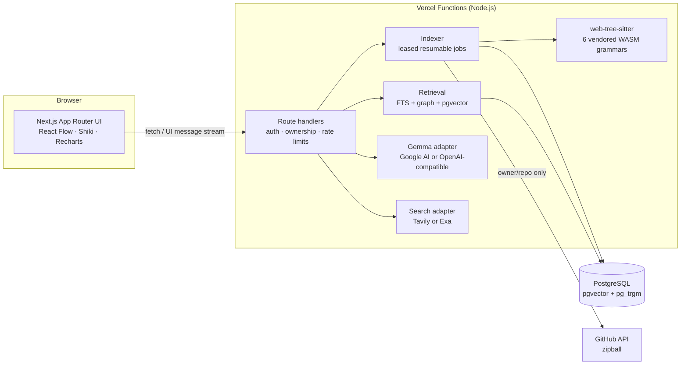

# CodeBaseGPT

**Understand any codebase, with receipts.** Import a repository, explore its real architecture in an interactive **Codebase Atlas**, ask **Gemma** questions that are answered from the code with **file-and-line citations**, and when you're stuck, use **Student Stuck Mode** to combine your repository's code with real web research.

Built for students and developers who are new to a codebase. MIT licensed.

---

## What it does

| | |
|---|---|
| **Codebase Atlas** | Tree-sitter parses TypeScript, JavaScript, Python, Java, C and C++ into files, symbols, imports and calls. Three layouts: *Architecture* (folders that expand progressively, with imports aggregated between them), *Dependencies* (file→file, optionally with external packages), and *Symbols & calls* (statically resolved call edges). Pan, zoom, minimap, search, language/folder filters, incoming/outgoing highlighting, a details panel with real source, and a keyboard-friendly **Outline** view of the same graph. Graphs are capped at 400 nodes and ranked by connectivity. |
| **Cited answers (Gemma)** | Hybrid retrieval: identifier-aware Postgres full-text search, plus symbol definitions and **call sites** from static analysis, plus importers of the focused file, plus optional pgvector embeddings. Gemma answers only from the numbered evidence (`[C1]`…). Each citation opens the exact lines. The server validates citation labels and flags any the model invented. With no matching code, it says so and **makes no model call**. |
| **Student Stuck Mode** | Paste a problem and error. The tool finds related code (stack-frame function names guide retrieval), builds editable search queries from the error signature (URLs, emails and token-like strings are stripped), runs a **real** Tavily or Exa search, and explains the problem step by step at beginner, intermediate or advanced level. Repository evidence, web sources (`[W1]`…) and the AI's reasoning are shown as three separate sections. |
| **Insights** | Measured from the index: language and line counts, symbol kinds, most-depended-on files, fan-out, import cycles (Tarjan SCC), unresolved imports, largest files, external packages, and a documented complexity heuristic (labelled as a heuristic, not a bug report). |
| **Workspace** | Email/password plus GitHub and Google OAuth (Better Auth), history, saved answers and web sources, settings, ⌘K command palette, dark and light themes, and responsive layouts down to 375 px. |

Nothing here is mocked in production flows. When Gemma, web search or OAuth isn't configured, the UI says exactly which variable is missing and still does everything else (indexing, Atlas, retrieval, insights).

## Architecture



More detail in [docs/architecture.md](docs/architecture.md).

**Stack:** Next.js 16 (App Router, Cache Components) · React 19 · strict TypeScript · Tailwind CSS 4 · Better Auth · Drizzle ORM · PostgreSQL (Neon in production, embedded PGlite for local development and tests) · AI SDK 7 · React Flow (`@xyflow/react`) · Recharts · Shiki · Zod · Vitest · Playwright.

## Quick start (local)

Requirements: Node.js 22 or newer and npm. No database, Docker or API keys are needed to start.

```bash
git clone https://github.com/tehsaad/CodeBaseGPT.git
cd CodeBaseGPT
npm install
cp .env.example .env.local     # optional: add keys to enable Gemma, search and OAuth
npm run dev                     # http://localhost:3000
```

Without `DATABASE_URL`, an embedded Postgres (PGlite, with pgvector and pg_trgm) is created in `.data/pglite` and migrated automatically. Create an account, then import a public repository such as `sindresorhus/ky`.

To enable answers and research, set at least:

```bash
GEMMA_MODEL=gemma-4-26b-a4b-it
GEMMA_API_KEY=...        # https://aistudio.google.com/apikey
TAVILY_API_KEY=...       # https://tavily.com
```

See [docs/gemma.md](docs/gemma.md), [docs/web-search.md](docs/web-search.md) and [docs/authentication.md](docs/authentication.md).

## Scripts

| Command | What it does |
|---|---|
| `npm run dev` | Development server |
| `npm run build` / `npm start` | Production build and server |
| `npm run typecheck` | `tsc --noEmit` (strict) |
| `npm run lint` | ESLint (Next core-web-vitals + TypeScript + React Compiler rules) |
| `npm test` | Unit and integration tests (Vitest, in-memory Postgres) |
| `npm run test:e2e` | Playwright end-to-end tests (desktop and mobile). Run `npx playwright install chromium` once. |
| `npm run db:migrate` | Apply `drizzle/` migrations to `DATABASE_URL` |
| `npm run db:generate` | Generate a migration after editing `lib/db/schema.ts` |

## Testing

- **Unit** (`tests/unit`): Tree-sitter extraction and line ranges for all six languages; file filtering, `.gitignore`, secret exclusion and redaction; archive path safety; GitHub URL parsing (SSRF); external-URL safety; Argon2id hashing; citation parsing and validation; prompt fencing against delimiter breakout; token budgeting; query and error-signature extraction.
- **Integration** (`tests/integration/pipeline.test.ts`): a multi-language fixture repository is imported **through the real API route handlers**, indexed by the real job runner, and checked for:
  - import edges, call resolution, Atlas graphs, insights, retrieval ranking, and citations mapped to real lines
  - prompt-injection fencing, empty-retrieval and unconfigured-provider honesty, and provider errors
  - Stuck Mode with and without search
  - cross-user isolation (IDOR), rate limiting, and rejection of malformed URLs, path traversal and archive bombs

  Only the LLM and search provider are mocked (AI SDK `MockLanguageModelV4`).
- **Semantic retrieval** (`tests/integration/embeddings.test.ts`): the embed phase and pgvector search, using a deterministic test-double embedder.
- **Auth origin** (`tests/integration/auth-origin.test.ts`): cross-site requests rejected; the configured origin and Vercel preview origins accepted.
- **End-to-end** (`tests/e2e`, `npm run test:e2e`): sign-up validation, sign-in, the protected-route redirect, ZIP import through the UI, Atlas selection to source at the highlighted line, citation chips, Stuck Mode, isolation between users, mobile layout and navigation, and a WCAG 2.1 AA axe scan of 14 pages in both themes. Set `E2E_PROD=1` (after `npm run build`) to run against the production server; the suite also asserts zero CSP violations.
- **Model path end-to-end** (`npm run test:e2e:provider`): runs the app against a local OpenAI-compatible **test double** (`tests/e2e/mock-openai-server.mjs`) to exercise real streaming, citation chips, invented-citation flagging, saving, reload, and the Stuck explanation, without credentials.

## Deploying to Vercel

See [docs/deployment.md](docs/deployment.md). In short: create a Neon database (with the `vector` and `pg_trgm` extensions), set the environment variables from `.env.example`, run `npm run db:migrate`, and deploy. The function timeouts used here (up to 300 s for indexing) fit Vercel's defaults.

## Documentation

- [Architecture](docs/architecture.md): data model, indexing pipeline, retrieval, citations
- [Deployment (Vercel)](docs/deployment.md) and [Local development and troubleshooting](docs/development.md)
- [Authentication and OAuth](docs/authentication.md)
- [Gemma provider](docs/gemma.md) · [Web search](docs/web-search.md)
- [Security and privacy](docs/security.md) · [AI usage disclosure](docs/ai-usage.md)
- [Design system](design-system/MASTER.md)

## Supported languages and limitations

- **Symbols and imports:** TypeScript/TSX, JavaScript/JSX (ESM and CommonJS), Python, Java, C, and C++. Other text files (Markdown, JSON, YAML, Go, Rust, and more) are indexed for search and the source viewer but have no symbols.
- **Calls** are resolved statically within a file and into files it imports. Dynamic dispatch, callbacks, reflection, macros and runtime aliasing are not traced, and the UI says so.
- **Import limits:** 30 MB archive, 3,000 indexed files, 400 KB per file, 40 MB of source in total. ZIP uploads are limited to 4 MB (Vercel's request-body limit); larger projects should be imported from GitHub.
- **Private GitHub repositories** need the user to grant the `repo` scope in Settings. GitHub offers no read-only private scope for OAuth apps.
- Answers are only as good as retrieval and the configured model. Always check the citations.

## License

[MIT](LICENSE) © 2026 Saad Rizwan
