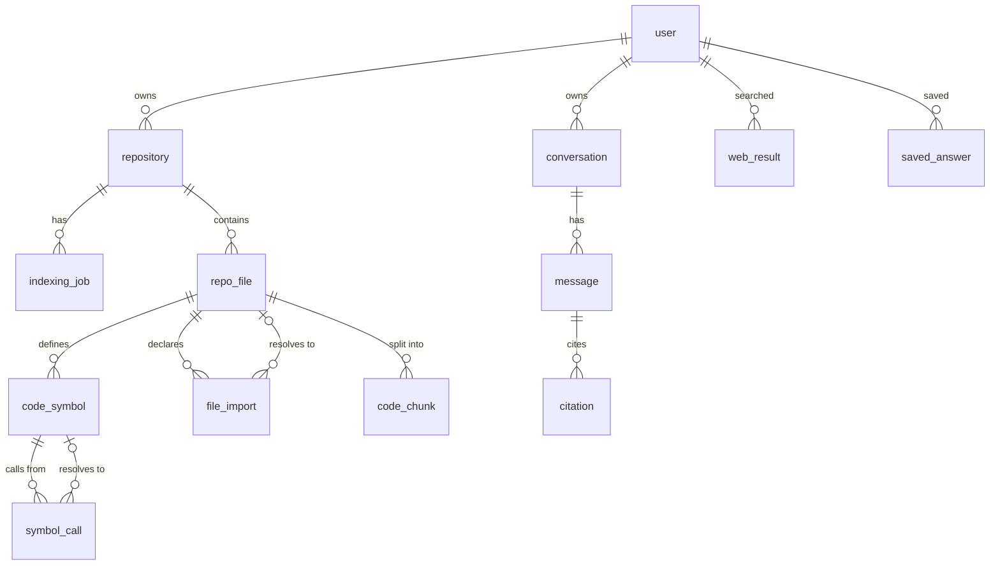

# Architecture

## Request flow

```mermaid
sequenceDiagram
  participant U as Browser
  participant A as Route handler
  participant J as Indexer (leased job)
  participant DB as Postgres
  participant G as Gemma
  U->>A: POST /api/repos {github url | zip}
  A->>A: auth · rate limit · parse owner/repo
  A->>A: download zipball (≤30 MB) → safe unzip → filter → redact
  A->>DB: files + job(phase=parse)
  A-->>U: 201 {repository, job}
  A--)J: after(): run until done
  loop until succeeded
    U->>A: POST /index {step} (resumes if the background worker stopped)
    J->>DB: lease → parse 25 files (Tree-sitter) → symbols, imports, calls, chunks
  end
  J->>DB: link: resolve imports → files, calls → symbols; counts
  U->>A: POST /chat {message, focus}
  A->>DB: retrieve (FTS + definitions + call sites + dependents [+ vectors])
  A-->>U: stream: data-evidence [C1..Cn]
  A->>G: policy + fenced evidence + question
  G-->>U: streamed text
  A->>A: validate [C#] labels against supplied evidence
  A-->>U: data-citations {used, invalid}; persist message + citations
```

## Code map

| Path | Responsibility |
|---|---|
| `app/(workspace)/…` | Authenticated UI: dashboard, repos, `repos/[id]/{atlas,ask,stuck,insights,source}`, saved, history, settings |
| `app/api/**/route.ts` | Thin route handlers: `withUser` (session) → `requireOwned*` (ownership) → Zod body → rate limit → domain function |
| `lib/code-intelligence/` | `languages`, `filter` (ignore rules, `.gitignore`, secrets, redaction), `parser` (Tree-sitter), `resolve` (imports), `chunker` |
| `lib/ingest/` | `github` (SSRF-safe API client), `archive` (safe unzip), `indexer` (jobs, leases, parse/link/embed) |
| `lib/ai/` | `retrieval`, `prompts` (policies and fencing), `citations`, `answer` (streaming and persistence), `stuck`, `provider` (Gemma), `embeddings` |
| `lib/search/` | Tavily/Exa adapters, URL safety, query building |
| `lib/repos/` | Import orchestration, Atlas graph builder, insights |
| `lib/security/` | API errors, `withUser`, ownership checks, Postgres rate limiter |
| `lib/db/` | Drizzle schema, driver switch (postgres-js ↔ PGlite), migrations in `drizzle/` |
| `components/` | `atlas/`, `chat/`, `stuck/`, `source/`, `insights/`, `repos/`, `shell/`, `ui/` |

## Data model



Every user-owned table has an `owner_id`, or reaches one through `repository` or `conversation`. Deleting a repository cascades to its files, symbols, edges, chunks, embeddings, conversations, and citations. `code_chunk.tsv` is a generated `tsvector` with a GIN index, and `embedding` is `vector(768)`.

## Indexing

- **Filtering** (`filter.ts`). Excludes dependency and build directories, lockfiles, binaries (by extension and by NUL bytes), minified or generated files, `.gitignore` matches, and secret files (`.env*`, keys, credentials, `.npmrc`, tfstate). Files containing a private-key block are dropped; known token formats (AWS, GitHub, OpenAI/Anthropic, Slack, Google, Tavily) are replaced with `[REDACTED_SECRET]`.
- **Archive safety** (`archive.ts`). Entries are inspected from the central directory before anything is inflated. Imports are rejected for: absolute or `..` paths and control characters; more than 25,000 entries; more than 200 MB declared uncompressed; any entry over 1 MB with a compression ratio above 200×; or inflated output larger than declared. Nothing is written to disk or executed.
- **Parsing** (`parser.ts`). A single walker records symbols (with exact 1-based line ranges, signatures, export flags, and a decision-point complexity score), imports (ESM, CommonJS `require`, dynamic `import()`, Python `import`/`from … import`, Java `import`, C/C++ `#include`), and call sites attributed to their enclosing symbol.
- **Resolution** (`resolve.ts`). Handles relative specifiers with extension and `index` probing; `.js`→`.ts` remapping; `tsconfig`/`jsconfig` `paths` and `baseUrl` (JSON with comments); Python relative and absolute modules (including a `src/` layout); Java fully-qualified classes; and C/C++ includes (relative, `include/`, unique suffix match). Anything else is labelled `external` or `unresolved`, never guessed.
- **Chunking** (`chunker.ts`). One chunk per top-level symbol. Classes over 120 lines are split into a header chunk plus method chunks, and code between symbols is chunked in 60-line windows with overlap. The search text adds split identifiers (`getUserSession` → `get user session`).
- **Jobs.** `UPDATE … WHERE lease_until < now() RETURNING` grants a 90 s lease, so only one worker processes a job. Each 25-file batch runs in one transaction that deletes, then re-inserts, that batch's derived rows, which makes retries idempotent. Three consecutive failures mark the job failed, and cancellation is checked between batches.

## Retrieval and citations

1. **Focus.** A symbol or line range selected in the Atlas or source viewer is included first. A line range is resolved to its enclosing symbol.
2. **Lexical.** Light suffix stemming plus prefix matching through `to_tsquery('simple', …)`, ranked by `ts_rank_cd`. Path and symbol-name matches get a boost; tests and docs are down-weighted unless the question is about them.
3. **Semantic** (optional). Cosine distance over pgvector, merged by reciprocal-rank fusion.
4. **Static analysis.** Definitions of identifiers named in the question, their call sites, and files importing the focused file.
5. **Packing.** Overlap removal, at most 3 chunks per file, and a 22 K-character budget. The prompt is then trimmed again to the model's context window.

The model sees numbered evidence fenced with backtick runs longer than any inside the content, and any delimiter tags inside it are neutralized. Citation labels in the output are validated, and unknown labels are reported to the user rather than linked.
